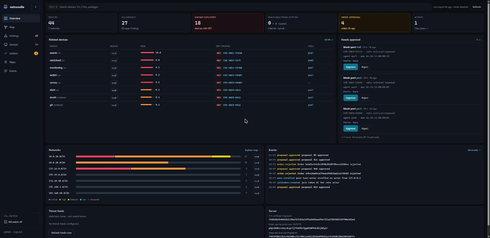

# netnoodle


netnoodle finds the devices in your network, finds their vulnerabilities, shows which ones are reachable from outside, and proposes actions. An operator approves an action, and an actor executes it for a limited time.



## What it does

- **Discovery:** subnet scanner, agents on Linux and Windows, imports from UniFi, Proxmox VE, Tailscale and Home Assistant. One device appears once, also when several sources report it.
- **Vulnerabilities:** packages and Windows builds are compared with OSV and Microsoft (MSRC), with the CISA list of known exploited vulnerabilities (KEV) and the FIRST exploit probability (EPSS).
- **Reachability:** each device and service is `internet`, `tunnel` (VPN, Tailscale) or `local`. Hosts, guests and containers are linked, so a problem on one shows the devices it can affect.
- **Decisions and actions:** rules propose actions (isolate, block a port). Safety checks and a kill switch apply. Actors for UniFi, Proxmox VE and Linux hosts (nftables) execute approved actions with signed orders, in dry-run mode by default, and undo them after their time limit.
- **Web interface:** a dark console with a map of the network in four views, and Home Assistant entities through MQTT.

## Quick start

### 1. Start the server (Docker, pre-built image)

```sh
mkdir netnoodle && cd netnoodle
curl -fsSLO https://raw.githubusercontent.com/JulianStremel/NetNoodle/main/compose.yaml
export NN_SERVER_IMAGE=ghcr.io/julianstremel/netnoodle-server:stable   # see the note
docker compose pull server && docker compose up -d server
docker compose logs server | grep -E 'password|fingerprint'   # first start: password of "admin", TLS fingerprint
```

Note: until the first release is promoted to `stable`, set `NN_SERVER_IMAGE` to a release tag, for example `ghcr.io/julianstremel/netnoodle-server:v0.1.0-rc.3`. Images exist for amd64, arm64 and arm/v7. To build from source instead: `git clone https://github.com/JulianStremel/NetNoodle.git && cd NetNoodle && docker compose up -d --build server`.

Open `https://<host>:7443` and log in as `admin`. To look around without real data, use the demo data: [Getting started](docs/guide/getting-started.md#procedure-try-netnoodle-with-demo-data).

### 2. Connect your network

- **Integrations** page: add UniFi, Proxmox VE, Tailscale or Home Assistant, notifications and threat intelligence. Use **Fetch fingerprint** and **Test connection**, then **Save**. Refer to [Integrations](docs/guide/integrations.md).
- **Peers** page, **Add peer**: select agent, scanner or actor and the platform. Copy the one-line command, run it on the device, and paste the setup code when the script asks for it. The script installs, enrolls and checks the connection; if a step fails, it removes everything again on the device and on the server. Refer to [Add a peer with one command](docs/guide/agents.md#add-a-peer-with-one-command).

## Parts

| Part | Language | Function |
|---|---|---|
| `nn-server` | Go | Central server: web interface, ingest, deduplication, vulnerability matching, decisions, orders |
| `nn-scan` | Go | Subnet scanner |
| `nn-agent` | Rust | Agent on Linux and Windows hosts: packages, services, interfaces, containers. Push or pull mode |
| `nn-actor` | Go | Executes approved actions. Backends `unifi`, `proxmox`, `host` (nftables), `log` |

## Documentation

| Topic | Page |
|---|---|
| Build, start, Docker, demo data | [Getting started](docs/guide/getting-started.md) |
| Add a peer with one command; scanner, agents (Linux, Windows), helpers, pull mode | [Scanner and agents](docs/guide/agents.md) |
| Integrations page: UniFi, Proxmox VE, Tailscale, Home Assistant, notifications, threat intelligence, AI provider | [Integrations](docs/guide/integrations.md) |
| Vulnerability data, reachability, risk | [Vulnerabilities and risk](docs/guide/vulnerabilities.md) |
| Rules, approvals, kill switch, actors | [Decisions and actions](docs/guide/actions.md) |
| Pages and Map views | [Web interface](docs/guide/web-interface.md) |
| Storage, releases, updates, data locations | [Operations](docs/guide/operations.md) |
| Plug-ins, protocol, design documents | [Extending netnoodle](docs/guide/extending.md) |
| Architecture and milestones | [docs/architecture.md](docs/architecture.md) |
| Decisions and accepted risks | [docs/DECISIONS.md](docs/DECISIONS.md) |

## Status

Milestones M0 to M6 are done: discovery, agents, vulnerability matching, the Map page, decisions and actors. Also done: updates from the web interface (host updater), the Integrations page, and adding a peer with one command. Next: notifications that ask you for decisions (Home Assistant, then Telegram; [design](docs/design/operator-interaction.md)) and an advisor that uses a language model of your choice (M7). Refer to [docs/architecture.md](docs/architecture.md) and the design documents in [docs/design](docs/design). Releases are release candidates (`v0.1.0-rc.N`) until the first stable release.

The connections to UniFi, Proxmox VE, Tailscale and Home Assistant are tested against test servers. Test them with your systems before you let an actor act (`dry_run: false`).
