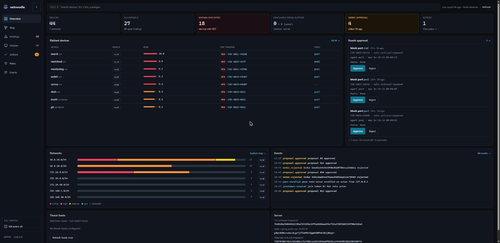
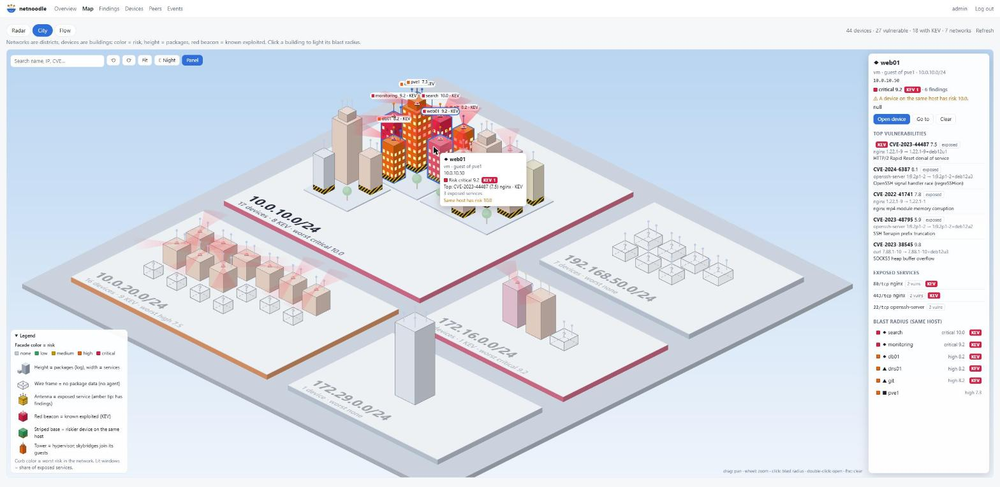

# Web interface

The pages of the web interface and the Map views.

[← Back to the README](../../README.md)

## Layout

- **Sidebar** (left): the pages with their counters (open findings, devices, decisions that wait for approval), the kill switch, and the user. Collapse it to an icon bar with the arrow button or the key `[`. The browser keeps your choice. On a narrow screen the sidebar is collapsed.
- **Search** (top, `Ctrl+K`): a CVE opens the findings with that CVE; other text opens the device list with that filter.
- **Overview**: number tiles, the riskiest devices, the decisions that wait for approval (with **Approve** and **Reject**), the risk of each network, the latest events, the state of the threat feeds, and the server keys.
- **Device page**: identifiers, reachability, tags, services, vulnerabilities, packages, and the devices on the same host.

## Map page

The **Map** page shows all devices in one view. Select a visualization at the top:

| View | What it shows |
|---|---|
| Constellation | Each network is a nebula and each device is a star. A Proxmox host and its guests look like a small solar system. A ring shows a known exploited vulnerability (KEV). |
| Radar | The riskiest devices are near the center. Each sector is a network. Guests are near their host. |
| City | Each network is a district and each device is a building. Height shows the number of packages, color shows the risk. A red beacon shows a known exploited vulnerability (KEV). |
| Flow | The path from a vulnerability to the package, the exposed service, the device, the host and the network. |

Click a device to see its blast radius: its host, its guests and the other guests of the same host. A compromise of one of them can affect the others. Double-click a device to open its page.

The risk of a device (0 to 10) comes from its worst open finding: 70 % of the CVSS score, plus 2 if attackers use the vulnerability (KEV), plus 1 if the package has a network service that listens on an address other than loopback, plus the EPSS probability.
